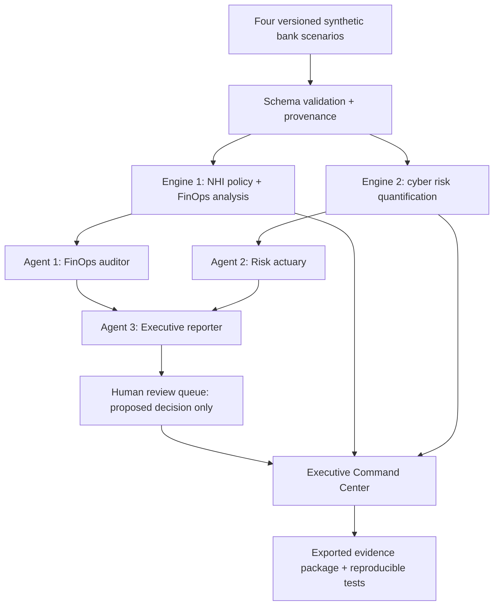

# AEGIS-NHI — Engineering Blueprint

**Status:** initial design contract · **Audience:** enterprise AI architecture, cyber risk, FinOps and executive decision support · **Data:** synthetic only

## The business outcome

Answer: **What happened? What is the exposure? What evidence supports it? What decision does a human need to make?**

This is a synthetic, read-only demonstrator for CRO/CFO/CEO discussions, not a deployed bank service. No remediation endpoints, credential handling, customer accounts, cloud mutations, or real transactions.

## Architecture

**Trust boundaries:** model-generated prose is untrusted. Python services validate inputs, compute numerical results, authorize each tool invocation and enforce the final human approval boundary. Human approval changes only the *review status of a recommendation*; it never issues real remediation commands.

## Stack and rationale

| Layer | Decision | Reason |
|---|---|---|
| Runtime | Python 3.13, `uv`, `pytest`, `ruff` | Compatible with developer Mac; quick feedback |
| Data | Versioned JSON fixtures; Pydantic validation | Deterministic synthetic evidence and strict data contracts |
| Storage | SQLite | Local provenance, runs and approval history without cloud bills |
| Engines | Plain Python functions with typed outputs | Numeric correctness and policy enforcement independent of an LLM |
| Orchestration | Explicit bounded workflow with three agent roles | Clear, testable transitions rather than uncontrolled loops |
| Model integration | Optional OpenAI SDK after deterministic baseline | Narrative assistance only; schema-constrained; never source of truth for numbers |
| UI | Streamlit + Plotly | Fast interactive CRO/CFO/CEO executive experience |
| Export | JSON + downloadable executive report | Auditability and interview demonstration |
| CI | GitHub Actions | Repeatable tests, provenance checks, lint and smoke tests |

Do not add FastAPI, Kubernetes, Terraform, paid cloud, Kafka, vector DBs or a heavyweight multi-agent framework unless a demonstrated use case requires them.

## Four scenarios

1. **NHI / unauthorized third-party agent actions:** a simulated third-party agent has technical access but lacks a valid runtime grant for a requested banking operation. Distinguish *attempted* from *executed* actions. Engine output: permission decision, denial evidence, optional conditional loss scenario.
2. **Cyber vulnerability / data exposure:** synthetic service principal and excessive permissions coupled to a vulnerable data access path. Engine output: risk conditions, affected synthetic asset scope and uncertainty-bearing loss ranges, without asserting a breach happened.
3. **Runaway agent / GPU and token economics:** repeating tool calls, elevated synthetic inference volume and cloud spend. Engine output: observed synthetic spend anomaly, projected incremental spend under scenario assumptions, and bounded-run control.
4. **Shadow AI / data handling:** synthetic unapproved AI application workflow and restricted data classification. Engine output: policy finding, containment recommendation for human review and *modeled* incident exposure, without claiming actual leakage.

## Event contracts

Each `event` has `event_id`, `scenario_id`, `occurred_at`, `actor_type`, `identity_id`, `resource_id`, `requested_action`, `outcome` and `evidence_ids`.

Each `grant` has `grant_id`, `identity_id`, `resource_id`, `allowed_actions`, `issued_at`, `expires_at` and `approved_by` (a synthetic fixture). A grant cannot be inferred from general tool capability.

Each `risk_assessment` includes `scenario_id`, `assumptions`, `model_version`, `seed`, `simulations`, `loss_event_frequency`, `loss_magnitude`, `expected_annual_loss`, `p10`, `p50`, `p90`, `evidence_ids`, `limitations`, and `created_at`.

Every monetary value has a **currency, period, category and basis** (`synthetic_observed`, `calculated`, `modeled`, or `hypothetical`). Historical cloud cost and possible AI token cost may not be added without confirmed non-overlap.

## Detection and quantification

**Policy:** Identity → capability → requested resource/action → live scoped grant → explicit allow/deny → evidence. Deny by default for missing, expired, oversized or malformed grants.

**FinOps:** Reconcile synthetic cost events; detect repeated tool-call signatures and call amplification, spend drift and per-inference unit cost. Differentiate opportunity estimates from realized savings.

**Cyber risk:** FAIR-inspired separation of loss-event frequency and loss magnitude. Use explicit bounded input distributions and seeded Monte Carlo simulations. Report estimated expected annual loss plus P10/P50/P90 *distribution quantiles*, stating the confidence and assumptions are subjective synthetic modeling choices. Provide scenario comparisons and sensitivity; do not sum correlated scenario exposure as though independent.

**Decision economics:** Compare a modeled risk reduction to implementation and operating costs only when the assumption provenance is documented; never call model output guaranteed ROI.

## Governed agent flow

`INGESTED → VALIDATED → ANALYZED → QUANTIFIED → DRAFTED → PENDING_REVIEW → APPROVED | REJECTED`

- Agent 1 (`FinOpsAuditor`): read-only investigation into synthetic spend and tool telemetry.
- Agent 2 (`RiskActuary`): calls deterministic seeded risk quantification, adds evidence links and assumptions.
- Agent 3 (`ExecutiveReporter`): produces structured executive briefing and suggested questions.
- Every agent run records input hashes, tool names and counts, model version, output hashes, failure reasons and execution status.
- Bounded execution: allowlisted tool registry; maximum 12 tool calls and 3 model response calls per scenario, with per-call timeouts and explicit fail-closed behavior. These numbers are starting limits, not claims about production suitability.
- Tool outputs and user instructions are never treated as an authority grant. No agent may create its own approvals.
- The human review queue stores *approval of a recommendation*, not approval to mutate a real bank system.

## Dashboard

1. **Executive Command Center:** synthetic evidence status, economic exposure, open decisions, top concentration risks and model uncertainty.
2. **NHI & Agent Controls:** identity/grant traces, deny reasons, scope and expiration, event timeline.
3. **FinOps & Token Economics:** cloud-spend signals, amplification, what-if planning and separation of observed synthetic vs hypothetical costs.
4. **Cyber Risk Quantification:** expected loss, scenario percentiles, sensitivity and control-change tradeoffs.
5. **Decision & Evidence Room:** auditable recommendation queue, evidence cards, assumptions, limitations, export.

## Definition of done

- Four scenarios reproduce from versioned data with no live credentials.
- Policy gate denies missing, expired and wrong-scope grants; tests include positive cases.
- Simulations produce identical results when given the same seed, model version and fixture.
- Every dashboard money figure reconciles to an engine output with an evidence classification.
- Agent runs stop at the tool-call and model-call caps and cannot execute network/cloud mutations.
- Every consequential decision waits for a human review record; no automatic remediation.
- CI green; screenshots reflect the working app, not mocked static layouts.
- README records what is implemented and what remains aspirational.

## Implementation order

**Vertical slice:** bootstrap package/test stack → build synthetic NHI misuse fixture → enforce grant check → quantify conditional loss → generate executive report → persist human review record → render single dashboard scenario → CI.

**Expansion:** integrate three additional fixtures, cost analysis, robust Monte Carlo sensitivity, full agent orchestration, interactive executive workspace and visual evidence gallery.

## Reference frameworks

- [NIST AI RMF](https://www.nist.gov/itl/ai-risk-management-framework) (AI risk governance; 1.0 revision underway)
- [OWASP Top 10 for Agentic Applications 2026](https://genai.owasp.org/resource/owasp-top-10-for-agentic-applications-for-2026/) (tool misuse, identity/privilege, trust boundaries)
- [FAIR Standard v3.0](https://www.fairinstitute.org/hubfs/Standards%20Artifacts/Factor%20Analysis%20of%20Information%20Risk%20%28FAIR%29%20Standard%20v3.0%20%28January%202025%29.pdf) (probabilistic frequency/magnitude modeling)

**Mappings to frameworks are design references, not compliance, certification, or a full FAIR-standard assessment.**
