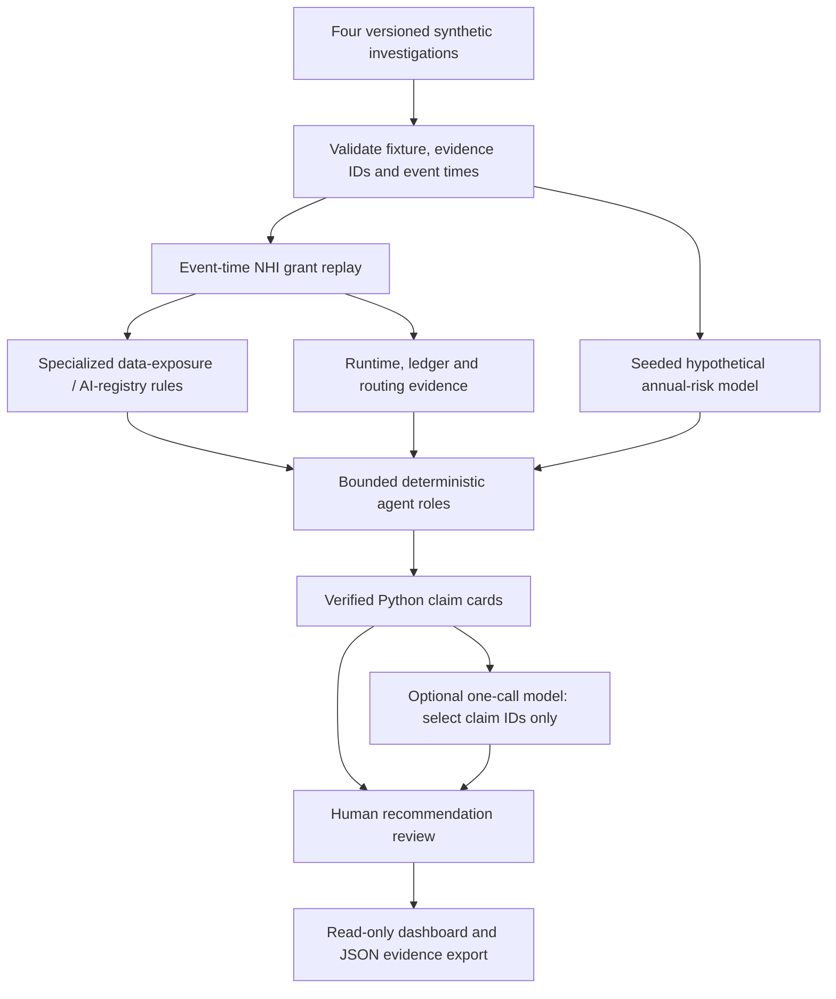

# AEGIS-NHI · Engineering Architecture (v0.5)

**AEGIS** = protective shield. **NHI** = non-human identity.

**Purpose:** Demonstrate enterprise-grade architecture judgment by separating agent capability from actual authorization, capturing deterministic evidence, quantifying hypothetical financial exposure, and keeping all consequential decisions under human review.

**Deployment:** Offline synthetic research / interview reference. No live bank, cloud, IAM, payment rail, customer database or autonomous remediation endpoint is connected.

## Implemented control flow

**Trust boundary:** Technical capability does not prove a scoped grant. A model response is treated as untrusted selection input, not as factual authority. A reviewer can approve or reject an investigation recommendation only; that action never grants runtime privileges or changes an external system.

## Four working synthetic scenarios

| Case ID | Fixture | Implemented detection or evidence |
|---|---|---|
| BANK-NHI-001 | data/scenarios/unauthorized_ai_agent.json | Four fictional events: one permitted read, three denied requests, scoped-grant replay, ledger evidence and declared region policy |
| BANK-FINOPS-002 | data/scenarios/runaway_agent.json | Six-minute fictitious tool-call series, workflow-call amplification, burst/repetition/budget findings, hypothetical token and GPU pricing |
| BANK-DATA-003 | data/scenarios/sensitive_data_exposure.json | Restricted classification, denied export attempt and separate region-policy exception, each tied to event evidence |
| BANK-SHADOW-004 | data/scenarios/shadow_ai.json | Fictional approved registry, unregistered AI principal, unregistered tool, and executed-versus-blocked event distinctions |

Each event is fictional. A recorded executed event does not establish a real breach, external action, data leak or deployment of monitoring.

## Actual data and evidence contracts

A case must explicitly declare synthetic=true and provide a unique case ID, title, scenario type, nonempty event/evidence collections, scoped grant list and annual loss model. The validator rejects duplicate evidence/event identifiers, unknown event evidence references, invalid or timezone-naive timestamps, and negative or nonfinite synthetic event cost.

An event has event_id, occurred_at, identity_id, resource_id, requested_action, observed_outcome (blocked or executed), synthetic_tool_cost_usd and evidence_ids. Scenario-specific metadata may add declared_destination_region and tool_id.

A grant has grant_id, identity_id, resource_id, allowed_actions, issued_at, expires_at and approved_by. The offline evaluator denies missing/expired/resource-mismatched/action-mismatched/unapproved grants, and separately identifies any fictional execution contrary to policy.

New specialized rule findings are tagged with the original event ID, rule name, authorization replay result, observed fixture outcome, evidence IDs and a scope limitation. Financial-risk assumptions are reported separately from event evidence and are never described as observed losses.

## Architecture decisions and economic judgment

**NHI / FinOps engine:** Python modules for event-time authorization replay, evidence-linked data classification and registry rules, synthetic ledger reconciliation, metadata-only destination-region checks, and independent runaway-tool forensics. An allowlisted ToolLedger caps workflow analysis invocations (default 12), hashes outputs and rejects non-allowlisted actions.

**Risk quantification engine:** A bounded, seeded Poisson loss-frequency model with triangular fictional severity, giving assumed expected annual loss and P10/P50/P90 annual outcome quantiles. These are not confidence intervals or calibrated actuarial forecasts. Risk-model sensitivity and illustrative control-investment economics remain separate from synthetic recorded tool charges. Token and GPU prices may overlap and must not be added without a verified billing boundary.

**Governed roles:** FinOps Auditor, Risk Actuary and Executive Reporter are explicit deterministic workflow stages; they are not autonomous LLM agents. No role self-approves privileges or triggers a bank, cloud, identity or network mutation.

## Evidence-locked AI narration

The narration module generates human-readable cards from validated report fields. Cards carry event evidence IDs or an explicit source assumption hash (for risk claims). The normal dashboard operates offline.

The optional OpenAI Responses API feature is initiated only by a human button click and sends fictional verified claim cards. One response call per click has a 180-token output cap, a 12-second timeout and no retries. The model may return only a JSON list of approved claim IDs. Unsupported IDs, duplicated claims, free-text additions or malformed JSON fail closed. Final wording comes exclusively from Python-approved claim cards, not model-generated prose.

Repeated clicks are new explicit user actions; there is no background model polling or hidden model activity. The optional integration requires its extra Python dependency and an environment-provided API key.

## Human authority and audit

Reviewer records are stored in a local, gitignored SQLite database keyed by the exact deterministic case-report ID or control-investment snapshot ID, plus a required named reviewer, rationale and decision. Approving a recommendation changes only an audit record; it cannot authorize transactions or remediation.

JSON evidence exports retain source fixtures, report IDs, detection rules, assumed financial model, output hashes, human-review status and scope caveats. SHA-256 identifies data artifacts; it is not a digital signature or independently immutable external audit trail.

## Seven Streamlit executive views

Executive Authority; Autonomous Perimeter; Ledger & FinOps; Agent Forensics; Capital at Risk; Audit & Decisions; Scenario Lab. The original six-view gallery shows running v0.4 screenshots. The Scenario Lab is a working v0.5 view validated using Streamlit AppTest; its visual screenshot belongs in a subsequent gallery capture from the actual running program.

## Quality gates

GitHub Actions installs the Python package, compiles code, runs Ruff critical checks, executes pytest (including scenario rule/negative tests and Streamlit AppTest render coverage), then produces an offline deterministic JSON case report. The model endpoint is never contacted during CI.

**Non-claims:** no real financial loss or loss avoidance, actual GPU bill, live discovery or security enforcement, network region attestation, real ledger processing, production-risk quantification, compliance certification, automatic incident response or financial transactions.

## Reference concepts

[NIST AI RMF](https://www.nist.gov/itl/ai-risk-management-framework) · [OWASP GenAI Security](https://genai.owasp.org/) · [FAIR Institute](https://www.fairinstitute.org/).

These are architectural references, not compliance or certification statements.

**Build the technology. Understand the economics. Earn the trust. Grow the business.**
